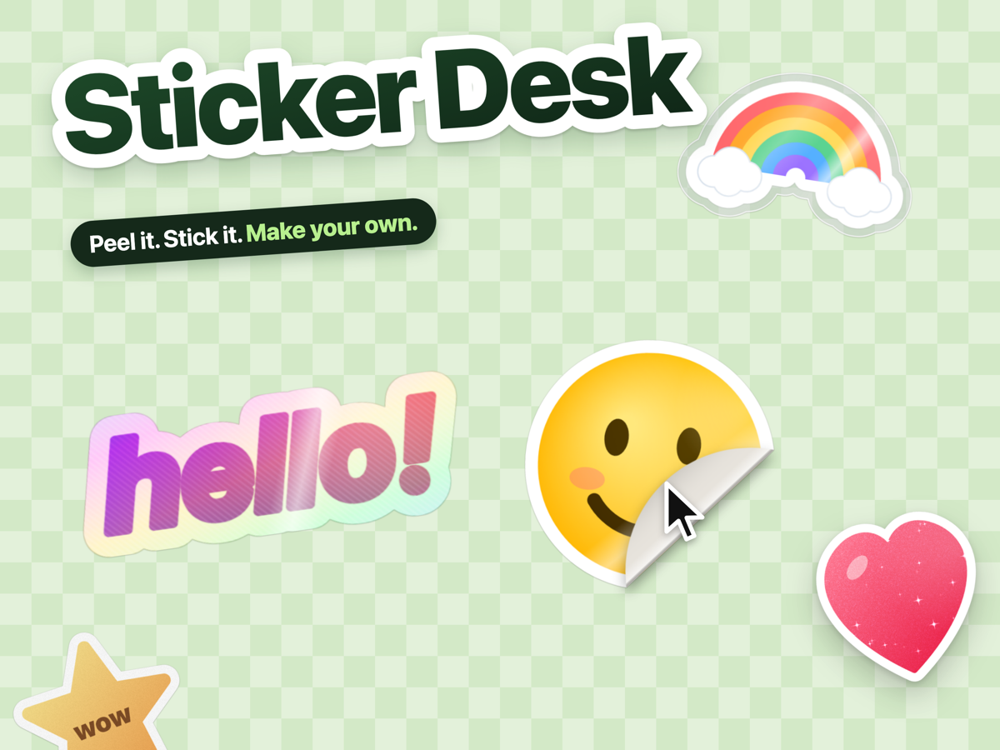

# Sticker Desk

Peel it. Stick it. Make your own.

**Try it:** https://rhea-thampy.github.io/sticker-desk/
**Mac app:** [Download for Mac](https://github.com/rhea-thampy/sticker-desk/releases/latest/download/Sticker-Desk-mac.zip) (free, macOS 13+, Apple silicon and Intel)



No accounts, servers or API keys: photos are turned into stickers on your own device and never uploaded.

## The `<sticker-board>` web component

A drop-in web component with a desk of digital stickers that behave like real ones.

- **Peel**: press a sticker's edge and it lifts. Pull, and it folds back over itself, showing its paper backing. Hovering only changes the cursor.
- **Carry**: pull far enough and it comes off the desk. It floats up with a large soft shadow, sways as you move, and you can scroll to rotate it.
- **Stick**: let go and it presses back down. Drop it on the bin to remove it.
- **Make your own**: upload, drag in or paste a photo. The main object in the centre is cut out and given a white die-cut border. Photos without one clear, centred object get an error that explains why.
- **Finishes and sizes**: Vinyl, Matte, Gloss, Laminated (clear plastic margin), Holo and Glitter. The shine follows the cursor, or the phone's tilt on mobile. Pick Small, Medium, Large or Huge before sticking it down.
- **Download a sticker**: tap a sticker, then **Download**, to get a transparent PNG with its finish included, named after the original photo, like `penguin.holo.sticker.png`. Visitors can also press **Download** in the sticker maker to save a new sticker without putting it on the desk.
- **Stickers on your desktop**: **Wallpaper** reshapes the desk to the visitor's screen proportions (landscape on a laptop, portrait on a phone). Visitors can use their own wallpaper image as the background, arrange stickers on it, and **Download wallpaper** to get a PNG at the screen's full resolution (e.g. 2880×1800 on a 1440×900 Retina screen). Websites can't set the wallpaper themselves, so visitors apply it in their device settings.
- The layout is saved in the visitor's browser (`localStorage`).

## Add it to your site

Copy `sticker-board.js` into your site's public or static folder, then:

```html
<script type="module" src="/sticker-board.js"></script>

<sticker-board height="560"></sticker-board>
```

**React / Next.js**: import it once on the client (`useEffect(() => { import('/sticker-board.js') }, [])`, or a `<Script type="module">`), then render `<sticker-board height="560" />` inside your section.

**Webflow / Framer / Squarespace**: paste both lines above into an Embed / Custom Code block, and host `sticker-board.js` (or paste its contents into a `<script type="module">`).

## Options

| Attribute | Values | Default |
|---|---|---|
| `height` | desk height in px | `560` |
| `surface` | `dots`, `mat` (green cutting mat), `plain` | `dots` |
| `theme` | `light`, `dark` | follows the OS |
| `storage-key` | localStorage key (for several boards on one site) | `sticker-board` |
| `no-starters` | start with an empty desk | off |

To match your brand, override CSS variables on the element:

```css
sticker-board {
  --sb-desk: #f3f0ea;      /* desk colour */
  --sb-dot: rgba(0,0,0,.1);
  --sb-accent: #1c1b1f;    /* primary button */
  --sb-accent-ink: #fff;
  --sb-radius: 22px;
  font-family: inherit;    /* picks up your site font */
}
```

Events: `sticker-created` (`detail.id`) and `sticker-error` (`detail.reason`).
Methods: `board.openStudio(file?)`, `board.setWallpaperMode(on)`, `board.downloadWallpaper()` and `board.reset()`.

## Sticker Desk: real stickers on your Mac desktop (`desktop/`)

A Mac app that puts the same peelable stickers directly on your desktop, on the wallpaper and under your windows.

**Install:** download `Sticker-Desk-mac.zip` from the [latest release](https://github.com/rhea-thampy/sticker-desk/releases/latest), unzip it and drag **Sticker Desk** into Applications. The app isn't registered with Apple, so the first time you open it macOS says it can't verify the developer: click Done, then go to **System Settings → Privacy & Security** and click **Open Anyway**. After that it opens normally.

**Build it yourself** (needs the Xcode command line tools):

```bash
desktop/build.sh
```

This makes a universal `desktop/build/Sticker Desk.app` (Apple silicon and Intel) and `desktop/build/Sticker-Desk-mac.zip`. It opens a window and sits in the Dock like any other app.

- **The window is the sticker maker.** Drop in, browse for or paste (⌘V) a photo. Pick a finish and a size (Small, Medium, Large or Huge), then **Stick it on my desktop**. The new sticker lifts above your windows for a moment so you see it land, then settles onto the desktop.
- **Download** saves a sticker as a transparent PNG with its finish, through the usual Save dialog (Downloads by default). It's in the maker, next to **Stick it on my desktop**, and on the toolbar that appears when you click a sticker on your desktop.
- Downloaded stickers (`*.sticker.png`) and transparent PNGs open in the maker too, skipping the cut-out, so you still choose their size. You can also drag an image onto the Dock icon or use **Open With → Sticker Desk** in Finder.
- **File → Make Sticker** (⌘N) brings the window back with a fresh maker.
- The bar at the bottom of the window shows how many stickers are on your desktop, with **Add samples**, **On top of windows** (stickers above everything, like stickers on a monitor; also ⌥⌘T) and **Peel all off**. The same options are in the **Stickers** menu.
- Peel, carry, stick, change the finish and bin stickers on the desktop exactly as on the website. Clicks anywhere off a sticker go through to the desktop as normal.
- Closing the window keeps the stickers on your desktop. Quitting takes them away until you open the app again.
- Stickers are saved in `~/Library/Application Support/Sticker Desk/`. Page errors are logged to `log.txt` there.
- Stickers live on the main display. Drawing pauses while windows fully cover the desktop, to save battery.

How it works: a transparent, click-through window covers the screen and hosts `sticker-board.js` in desktop mode (`<sticker-board desktop>`) in a web view. About 60 times a second the app asks the board whether the pointer is over a sticker, and only then does that layer take the click. The app window hosts the same component in maker mode (`<sticker-board maker>`) and hands each finished sticker to the desktop layer. Built with Swift and WebKit, with no dependencies. The icon is drawn by `desktop/icon.swift`. It's ad-hoc signed and isn't notarised by Apple, hence the Open Anyway step.
- **Help → Sticker Desk Website** and the link at the top of the window open this project's website.

## How the cut-out works

Everything runs in the visitor's browser, and photos are never uploaded anywhere.
The first time someone makes a sticker, the component lazy-loads Google's MediaPipe
*Interactive Segmenter* (`magic_touch`, Apache-2.0, about 6 MB, from jsDelivr and Google storage). It probes five points around the centre of the photo, then accepts the result only when:

- the object covers between 3% and 90% of the photo
- it doesn't run off the edges (at most 30% of the border)
- it's one solid shape, not scattered pieces, with a confident outline
- it sits near the centre
- at least 3 of the 5 probes find the same object (this rejects patterns, textures and busy scenes)

Otherwise the visitor sees "No clear object found. Upload an image with a clear object in the centre." with the specific reason.

## Licence

MIT, see [LICENSE](LICENSE). The cut-out uses Google's MediaPipe (Apache-2.0), loaded at runtime from jsDelivr and Google Cloud Storage.
